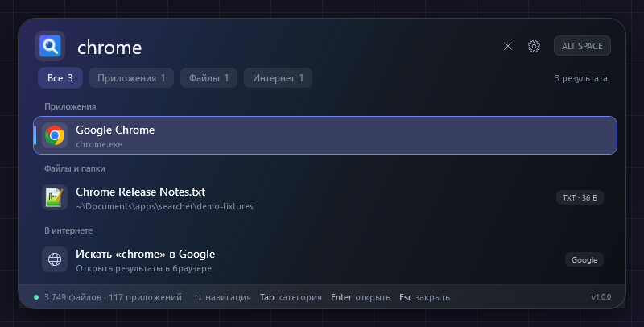
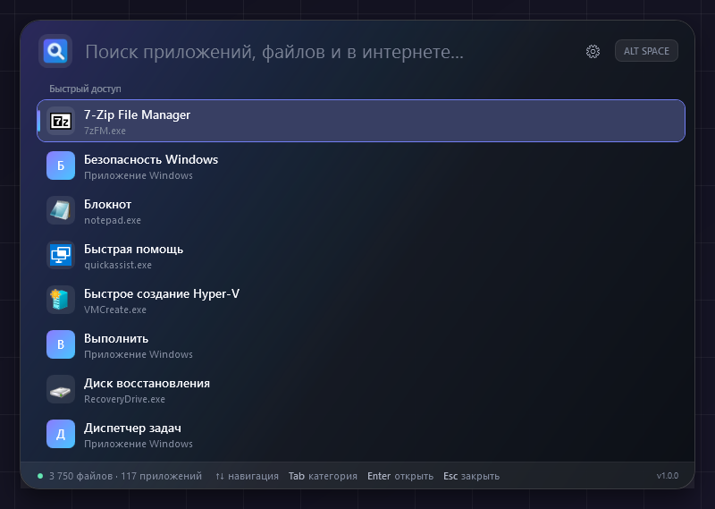
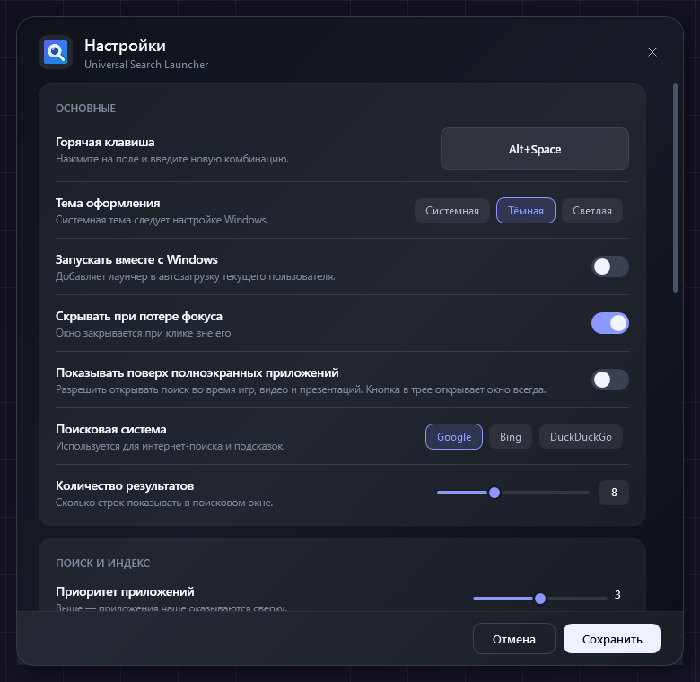
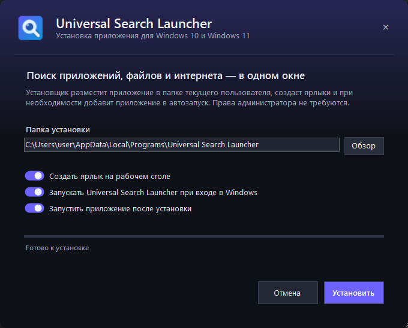

# Universal Search Launcher

Полноценный Windows-лаунчер в духе Spotlight и PowerToys Run: приложения, файлы и интернет в одном компактном окне, которое открывается по глобальной горячей клавише.



## Что реализовано

- **Глобальная горячая клавиша** `Alt+Space` (можно изменить): открывает и скрывает окно в любом приложении, повторное нажатие закрывает. Работает корректное восстановление прежней комбинации при конфликте.
- **Реальный поиск приложений** из меню «Пуск» и `AppsFolder`/UWP, с разрешением `.lnk`, ярлыков, исполняемых файлов и локализованных названий. Дубликаты схлопываются.
- **Реальный поиск файлов и папок** в выбранных папках: фоновый индекс, сохранение в SQLite, обновление через `FileSystemWatcher` и период, исключения системных/временных папок.
- **Умное ранжирование**: точное совпадение, начало слова, подстрока, акронимы, fuzzy-совпадения и опечатки, несколько слов, недавние и частые запуски, закреплённые приложения.
- **Интернет-поиск**: Google, Bing, DuckDuckGo; распознавание доменов и URL с открытием сайта напрямую.
- **Современный интерфейс**: стеклянная панель, закруглённые углы, тени, плавная анимация, тёмная/светлая/системная тема, адаптивная высота окна.
- **Защита полноэкранного режима**: по умолчанию горячая клавиша не открывает поиск поверх игр, видео и презентаций; поведение можно разрешить отдельным переключателем в настройках.
- **Клавиатурная навигация**: стрелки, Tab/Shift+Tab по категориям, Enter, Esc, Ctrl+Backspace, Ctrl+P, Ctrl+,.
- **Системный трей**: открыть поиск, настройки, проверка обновлений, выход.
- **Настройки**: горячая клавиша с захватом нажатия, автозапуск, тема, поисковик, число результатов, приоритеты категорий, индексируемые папки, исключения, история, канал обновлений.
- **История и статистика**: SQLite, недавние запросы, частые приложения, закрепление избранного, запоминание последнего выбранного результата.
- **Фоновая работа**: без окна и без значка на панели задач, только иконка в трее; аккуратное завершение и очистка ресурсов.
- **Установщик**: автономное self-contained приложение .NET 8 (не требует установленного .NET), per-user установка без администратора, ярлыки, автозапуск, запись в «Установленные приложения», деинсталлятор.

## Быстрый старт

### Установка

Запустите:

```text
dist\UniversalSearchLauncher-Setup-1.0.1.exe
```

Установщик предложит папку (по умолчанию `%LocalAppData%\Programs\Universal Search Launcher`), ярлыки, автозапуск и запуск после установки. Права администратора не нужны.

После установки приложение работает в трее. Нажмите **Alt+Space** в любом приложении. Если комбинация занята другой программой, приложение сообщит об этом и останется доступным через трей; новую комбинацию можно назначить в настройках.

Подробнее: [docs/INSTALL.md](docs/INSTALL.md).

### Портативный вариант

Распакуйте `dist\UniversalSearchLauncher-1.0.1-portable.zip` в любую папку и запустите `UniversalSearchLauncher.exe`. Портативная сборка не создаёт ярлыки и записи установки, но использует те же настройки и индекс в `%LocalAppData%\UniversalSearchLauncher`.

## Управление

| Действие | Клавиши |
|---|---|
| Открыть / скрыть поиск | `Alt+Space` (настраивается) |
| Перейти к следующему / предыдущему результату | `↓` / `↑` |
| Открыть выбранное | `Enter` |
| Переключить категорию | `Tab` / `Shift+Tab` или клик по фильтру |
| Закрыть окно | `Esc` или повторное нажатие горячей клавиши |
| Очистить строку | `Ctrl+Backspace` или кнопка × |
| Закрепить выбранное приложение/файл | `Ctrl+P` или правый клик → «Закрепить» |
| Открыть настройки | `Ctrl+,` или шестерёнка |
| Контекстное меню результата | правый клик |

### Полноэкранные приложения

По умолчанию лаунчер **не открывается** по `Alt+Space`, если активное приложение занимает весь экран: игра, видеоплеер, презентация или киоск. Это предотвращает случайное перекрытие игрового процесса. Чтобы разрешить поиск поверх полного экрана, включите **Настройки → Основные → «Показывать поверх полноэкранных приложений»**.

Кнопка **«Открыть поиск»** в меню трея открывает лаунчер всегда — это осознанное действие пользователя.

Подробнее: [docs/HOTKEYS.md](docs/HOTKEYS.md).

## Как это работает

1. При запуске приложение читает настройки, кэш приложений и индекс файлов.
2. Индексы строятся в фоне; интерфейс не блокируется. Файловый индекс сохраняется в SQLite через системную `winsqlite3.dll`, без сторонних SQLite-пакетов.
3. Каждое нажатие клавиши запускает новый поисковый запрос. Предыдущий запрос отменяется, результаты обновляются после каждой буквы.
4. Приложения и интернет показываются сразу, файлы подключаются по мере готовности. Группы упорядочиваются согласно настройкам приоритетов.
5. Результаты ранжируются по релевантности и усиливаются статистикой использования, недавностью и закреплением.
6. Выбор открывает приложение/файл/папку/URL через оболочку Windows; история и статистика сохраняются асинхронно.

Подробнее: [docs/ARCHITECTURE.md](docs/ARCHITECTURE.md).

## Скриншоты

| Пустой лаунчер | Настройки |
|---|---|
|  |  |



## Данные и приватность

Всё хранится локально в `%LocalAppData%\UniversalSearchLauncher`:

- `settings.json` — настройки;
- `data\index.db` — индекс файлов, история и статистика;
- `data\apps.json` — кэш найденных приложений;
- `logs\app.log` — журнал для диагностики.

Приложение не отправляет телеметрию. Интернет используется только при явном интернет-поиске/открытии URL и при ручной проверке обновлений, если задан канал обновлений.

## Сборка из исходников

Требования:

- Windows 10/11 x64;
- .NET SDK 8.0;
- .NET Framework 4.8 (для компиляции установщика и деинсталлятора; входит в Windows 10/11);
- интернет для NuGet (или заранее подготовленный локальный кэш пакетов).

```powershell
powershell -NoProfile -ExecutionPolicy Bypass -File .\scripts\build-release.ps1
```

Скрипт запускает тесты, публикует self-contained приложение, собирает деинсталлятор и установщик, создаёт портативный архив и архив исходников в `dist\`.

Подробнее: [docs/BUILD.md](docs/BUILD.md).

## Тесты

```powershell
dotnet run --project tests\UniversalSearchLauncher.Tests\UniversalSearchLauncher.Tests.csproj -c Release
```

Проверяются fuzzy-ранжирование, URL-распознавание, исключения, индексирование, открытие путей, настройки и производительность. В текущей сборке — **61 успешная проверка**; поиск по 100 000 файлов занимает порядка **55–60 мс** на тестовой машине.

## Структура проекта

```text
src/
  UniversalSearchLauncher.Core/   модели, fuzzy-поиск, URL, сканер файлов
  UniversalSearchLauncher/        WPF-приложение, сервисы, темы, SQLite
tests/
  UniversalSearchLauncher.Tests/  консольный набор тестов
installer/
  Setup.cs                        установщик (.NET Framework 4.8)
  Uninstaller.cs                  деинсталлятор
scripts/
  build-release.ps1               полная сборка и упаковка
docs/                             инструкции и скриншоты
dist/                             готовые артефакты
```

## Ограничения

- Установщик не подписан сертификатом, поэтому SmartScreen может показать предупреждение. Для распространения рекомендуется подписать Setup подписью Authenticode.
- Индексируется не весь диск, а выбранные папки — это осознанное решение для скорости и приватности. Папки и исключения настраиваются.
- Поиск по содержимому документов не выполняется: индексируются имена, пути, папки и расширения. Это соответствует требованиям к быстрому локальному поиску и не создаёт тяжёлый полнотекстовый индекс.
- Канал обновлений по умолчанию не задан. «Проверить обновления» сообщит об этом; URL JSON-манифеста можно указать в настройках.
- UWP-приложения без доступной иконки показываются аккуратной монограммой; для Win32-приложений используются настоящие иконки оболочки.

## Лицензия

Проект передан заказчику как есть. Сторонние NuGet-пакеты в приложении не используются.
